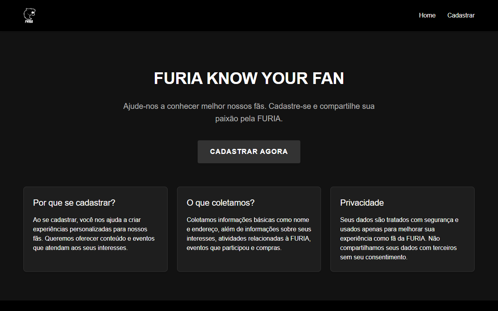

# FURIA Know Your Fan

A fan registration app for FURIA: fans sign up with their personal details, pick their esports interests and attach identity documents, and everything is stored in Firebase for the team to know its audience better.

Built for FURIA Tech's *Know Your Fan* technical challenge, as part of a software engineering selection process.

**[Live demo →](https://furia-know-your-fan-black.vercel.app)**



## Features

- **Validated sign-up form** built with React Hook Form: name, CPF, phone, e-mail, address, postcode, city and state, with inline error messages.
- **Real CPF validation.** Check digits are verified with the official algorithm, not just the format.
- **Interest picker** for FURIA's titles and activities (CS, Valorant, League of Legends, Rainbow Six, merchandise, live events…).
- **Document upload** with drag and drop, PDF/JPEG/PNG only and a 5 MB limit per file.
- **Firebase persistence.** Each registration, including its documents, is saved to Cloud Firestore.
- **Three routes:** landing page, registration and confirmation, with a responsive black-and-white layout in FURIA's style.

## Stack

React 19 · Vite · React Router · React Hook Form · Firebase (Cloud Firestore)

## Running locally

```bash
git clone https://github.com/gabrielmds0/FuriaKnowYourFan.git
cd FuriaKnowYourFan
npm install
npm run dev        # http://localhost:5173
```

The app points at the Firebase project configured in `src/assets/services/firebase.js`. To use your own, create a Firebase project with Cloud Firestore enabled and replace that config.

> **Firestore rules.** Registrations contain personal data (CPF, address, documents). Keep the `fans` collection write-only for visitors and readable only by authenticated staff; never ship open `allow read, write: if true` rules.

## Project structure

```
src/
├── assets/
│   ├── components/   UserForm (fields + CPF validation), DocumentUpload, Header, Layout
│   ├── pages/        Home, RegisterFan, Success
│   └── services/     firebase: app init and saveFanData
├── App.jsx           routes
└── main.jsx
```
